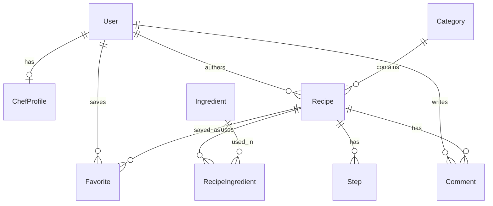

# RecipeBook API

ASP.NET Core 8 Web API for a recipe platform: users publish recipes (with nested steps and ingredients in one request),
comment, and save favorites. JWT auth with roles (Admin / User), FluentValidation, AutoMapper, EF Core (SQLite), Swagger.

## Run
1. Open `RecipeBook.sln` in Visual Studio 2022 (17.8+, .NET 8 SDK). Set `RecipeBook.Api` as startup project.
2. Create the first migration (Package Manager Console, Default project = `RecipeBook.Api`):
   `Add-Migration InitialCreate`
   (CLI: `dotnet ef migrations add InitialCreate --project RecipeBook.Api`). Commit the generated `Migrations/` folder.
3. Press F5. On startup the app applies migrations (`Database.Migrate()`) and seeds data. Swagger opens at `/swagger`.
   Manual alternative: `Update-Database` / `dotnet ef database update`.

Database: SQLite file `recipebook.db` (connection string in `appsettings.json`). To use SQL Server/PostgreSQL swap the provider
package + `UseSqlite` in `Program.cs`, delete the `Migrations` folder and re-run `Add-Migration`.
If you ran the app before adding a migration, delete `recipebook.db` first.

## Seed accounts
| Role  | Email                 | Password   |
|-------|-----------------------|------------|
| Admin | admin@recipebook.com  | Admin123!  |
| User  | user@recipebook.com   | User123!   |

Registration always creates a `User`; the only Admin is the seeded one. Seed also has 6 categories, 14 ingredients and a sample recipe.

## Configuration
`appsettings.json` -> `Jwt:Key` (>= 32 chars), `Jwt:Issuer`, `Jwt:Audience`, `Jwt:ExpiryHours` (8), `ConnectionStrings:Default`.

## Architecture
`Controllers` (HTTP only) -> `Services` (business rules, ownership, transactions; interface + DI) -> `Data` (DbContext, entities,
`IEntityTypeConfiguration` classes). Plus `DTOs`, `Validators`, `Mapping` (one Profile per module), `Common`
(exceptions, unified error format, validation filter, paging).

## Business rules (where)
- Ownership (author/admin -> else 403): `RecipeService.EnsureCanModify`, `CommentService.DeleteAsync`
- Update replaces steps/ingredients in one transaction: `RecipeService.UpdateAsync`
- Cascade deletes: `StepConfiguration`, `RecipeIngredientConfiguration`, `CommentConfiguration`, `FavoriteConfiguration`
- Category with recipes cannot be deleted: Restrict in `RecipeConfiguration` + 400 in `CategoryService.DeleteAsync`
- `UpdatedAt` set on every update.

## ER diagram

## Tests
`dotnet test` runs `AssertConfigurationIsValid()` for AutoMapper and a few validator tests.
`RecipeBook.Api/RecipeBook.Api.http` contains the full manual scenario.
